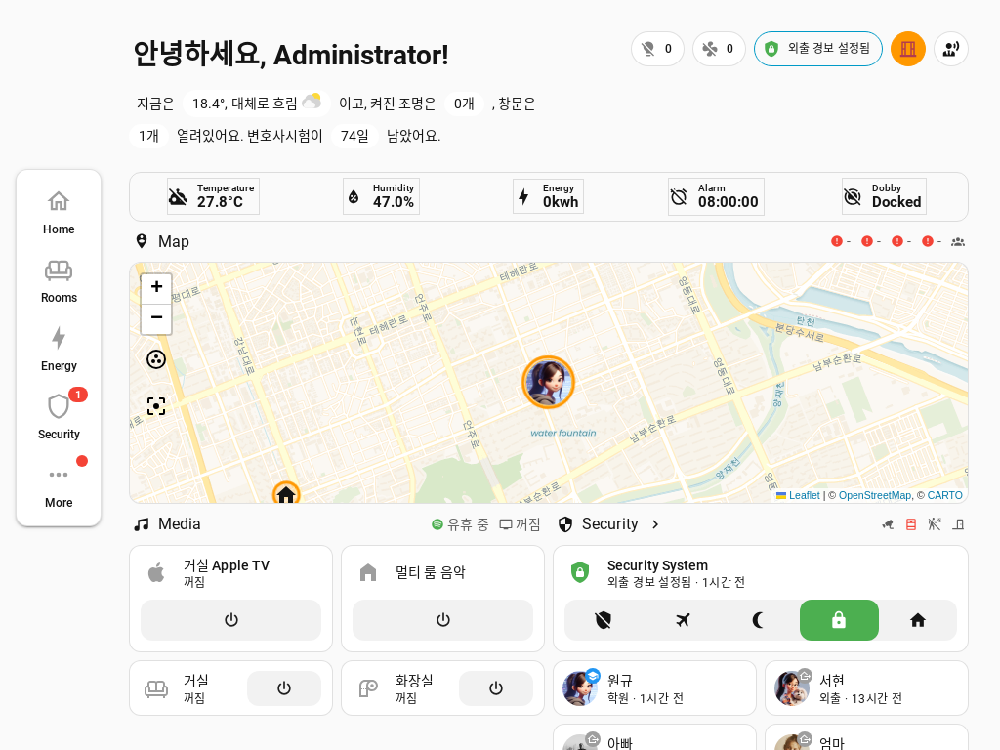
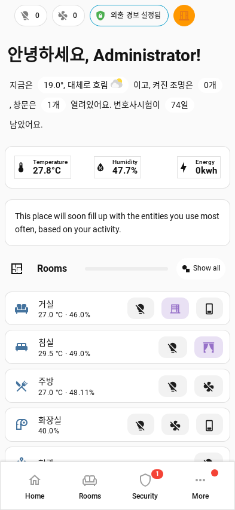
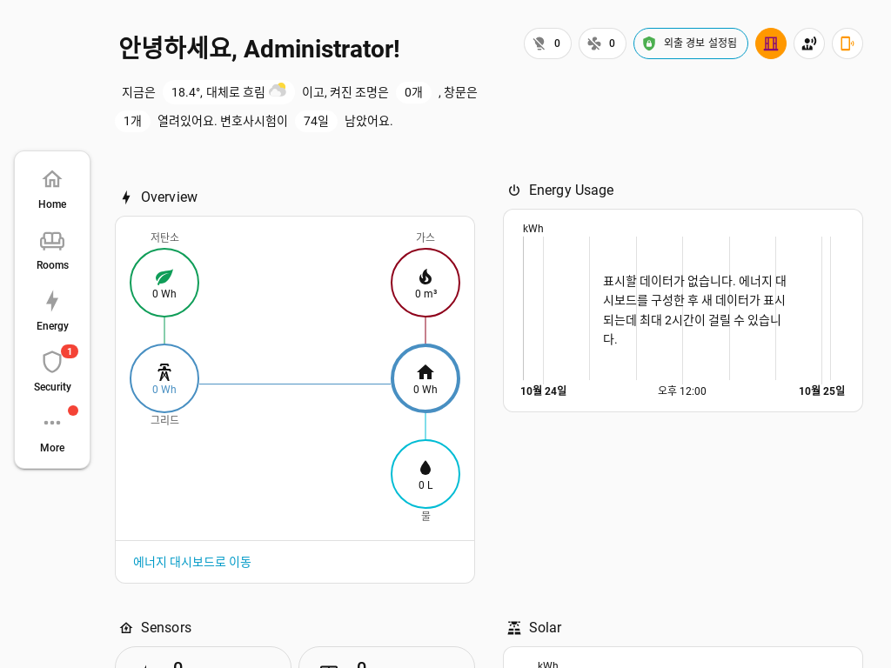

# Home Assistant Config

[![Maintained][maintenance-img]][github-url]

[![Last Commit][last-commit-img]][github-url]
[![Commit Activity][commit-activity-img]][github-url]
[![CI][ci-img]][github-url]
[![License][license-img]][license-url]
[![Stars][stars-img]][github-url]
[![Docs][docs-img]][docs-url]

> 2018년부터 운영 중인 개인 Home Assistant 설정. 1인 가구, 한국어 자동화 중심. (2026-05-31 갱신)

📚 **전체 문서: [saya6k.github.io/home-assistant-config][docs-url]**

---

## 한눈에 보기

  
  
  
  
  
  

<strong>📦 애드온</strong> (23)

| 이름 | 버전 | 상태 |
| --- | --- | --- |
| Advanced SSH & Web Terminal | `23.0.9` | started |
| ESPHome Device Builder | `2026.5.1` | started |
| Git pull | `9.0.1` | unknown |
| HASS MCP Proxy | `1.0.20` | started |
| Home Detector | `0.0.13` | started |
| iSponsorBlockTV add-on | `2.6.2` | started |
| Let's Encrypt | `6.3.2` | stopped |
| LLM Conversation Agent | `1.14.5` | started |
| Matter Server | `8.5.0` | started |
| Mosquitto broker | `7.1.0` | started |
| Music Assistant | `2.8.8` | started |
| NGINX Home Assistant SSL proxy | `4.2.0` | started |
| OpenTelemetry Collector | `0.12.14` | started |
| OpenThread Border Router | `3.0.0` | started |
| openWakeWord | `2.1.0` | started |
| Rematters | `0.1.28` | started |
| rethink | `0.1.0` | unknown |
| Samba share | `12.6.1` | started |
| Shelly Manager | `1.1.4` | started |
| Studio Code Server | `6.0.1` | started |
| Supertonic | `2.0.0` | started |
| Wardrowbe | `1.4.0` | started |
| Zensical | `0.1.0` | started |

<strong>🧩 HACS · 커스텀 통합</strong> (17)

- [Anniversaries](https://github.com/pinkywafer/Anniversaries)
- [Dawarich](https://github.com/AlbinLind/dawarich-home-assistant)
- [Discord Game](https://github.com/LordBoos/discord_game)
- [Dyson](https://github.com/libdyson-wg/ha-dyson)
- [HACS](https://github.com/hacs/integration)
- [Koreader](https://github.com/hudsonbrendon/ha-koreader)
- [Kr Component Kit](https://github.com/redchupa/kr_component_kit)
- [Life360](https://github.com/pnbruckner/ha-life360)
- [Openid Connect/Sso Authentication](https://github.com/christiaangoossens/hass-oidc-auth)
- [Remote Logger For Home Assistant](https://github.com/rhizomatics/remote_logger)
- [Restore Persistent Notification](https://github.com/andreadegiovine/homeassistant-restore-persistent-notifications)
- [Spook 👻 Your Homie](https://github.com/frenck/spook)
- [Steam Wishlist](https://github.com/boralyl/steam-wishlist)
- [Truenas](https://github.com/tomaae/homeassistant-truenas)
- [Voice Satellite](https://github.com/jxlarrea/voice-satellite-card-integration)
- [Voice Satellite   Llm Tools](https://github.com/jxlarrea/voice-satellite-card-llm-tools)
- [Washdata](https://github.com/3dg1luk43/ha_washdata)

<strong>🎨 HACS · Lovelace 플러그인</strong> (8)

- [Auto Entities](https://github.com/thomasloven/lovelace-auto-entities)
- [Button Card](https://github.com/custom-cards/button-card)
- [Card Mod](https://github.com/thomasloven/lovelace-card-mod)
- [Decluttering Card](https://github.com/custom-cards/decluttering-card)
- [Homeii Flow](https://github.com/r11a/homeii-music-flow)
- [Hui Element](https://github.com/thomasloven/lovelace-hui-element)
- [Mushroom](https://github.com/piitaya/lovelace-mushroom)
- [Template Entity Row](https://github.com/thomasloven/lovelace-template-entity-row)

### 플랫폼

  
  
  
  
  
  
  
  
  
  

### 프로토콜 · HACS

  
  
  
  
  

### 음성과 AI

  
  
  
  
  
  
  
  

### 서비스

  
  
  
  
  

---

## 문서 / Documentation

소스는 [`docs/`](./docs/) — zensical로 빌드되어 GitHub Pages에 배포됩니다.

| 영역 | 한국어 | English |
| --- | --- | --- |
| 하드웨어 | [hardware.md](./docs/hardware.md) | [en/hardware.md](./docs/en/hardware.md) |
| 플랫폼 | [platform/](./docs/platform/) | [en/platform/](./docs/en/platform/) |
| 통합 | [integrations/](./docs/integrations/) | [en/integrations/](./docs/en/integrations/) |
| 자동화 | [automations.md](./docs/automations.md) | [en/automations.md](./docs/en/automations.md) |
| 대시보드 | [dashboards.md](./docs/dashboards.md) | [en/dashboards.md](./docs/en/dashboards.md) |
| 음성과 AI | [voice-and-ai.md](./docs/voice-and-ai.md) | [en/voice-and-ai.md](./docs/en/voice-and-ai.md) |
| 옵저버빌리티 | [observability.md](./docs/observability.md) | [en/observability.md](./docs/en/observability.md) |
| 에너지 | [energy.md](./docs/energy.md) | [en/energy.md](./docs/en/energy.md) |
| 서비스 | [services/](./docs/services/) | [en/services/](./docs/en/services/) |
| 보관소 · 참고 | [retired.md](./docs/retired.md) · [resources.md](./docs/resources.md) | [en/retired.md](./docs/en/retired.md) · [en/resources.md](./docs/en/resources.md) |

## 도메인별 엔티티

| Domain | Count |
| --- | --- |
| automations | 49 |
| binary_sensors | 221 |
| device_trackers | 17 |
| lights | 14 |
| media_players | 16 |
| sensors | 988 |
| switches | 168 |
| others | 535 |
| **Total** | **2008** |

## 화면

  
  
  

## License

MIT — see [LICENSE](LICENSE). `secrets.yaml` 은 포함되지 않습니다.

> [!CAUTION]
> 이 설정은 매일 진화합니다. 문서가 항상 최신은 아닐 수 있습니다.

<!-- Footnotes -->

[github-url]: https://github.com/saya6k/home-assistant-config
[license-url]: https://github.com/saya6k/home-assistant-config/blob/main/LICENSE
[docs-url]: https://saya6k.github.io/home-assistant-config

[maintenance-img]: https://img.shields.io/maintenance/yes/2026?style=flat-square
[last-commit-img]: https://img.shields.io/github/last-commit/saya6k/home-assistant-config?style=flat-square
[commit-activity-img]: https://img.shields.io/github/commit-activity/m/saya6k/home-assistant-config?style=flat-square
[ci-img]: https://img.shields.io/github/actions/workflow/status/saya6k/home-assistant-config/release.yml?style=flat-square&label=CI
[license-img]: https://img.shields.io/github/license/saya6k/home-assistant-config?style=flat-square
[stars-img]: https://img.shields.io/github/stars/saya6k/home-assistant-config?style=flat-square
[docs-img]: https://img.shields.io/badge/docs-saya6k.github.io-1f6feb?style=flat-square&logo=github

<!--
Generated by the [readme custom integration](https://github.com/custom-components/readme).
Service: readme.generate
-->
