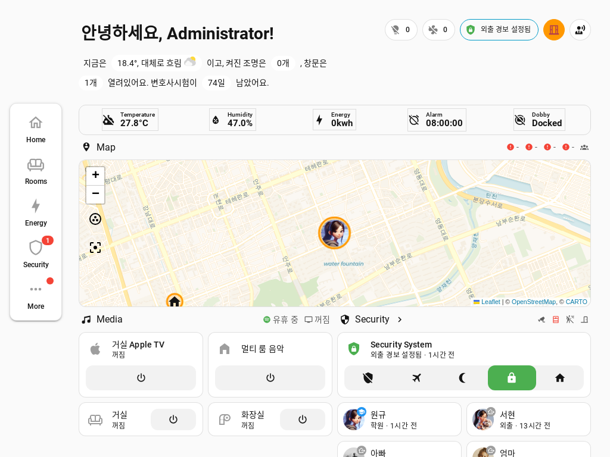
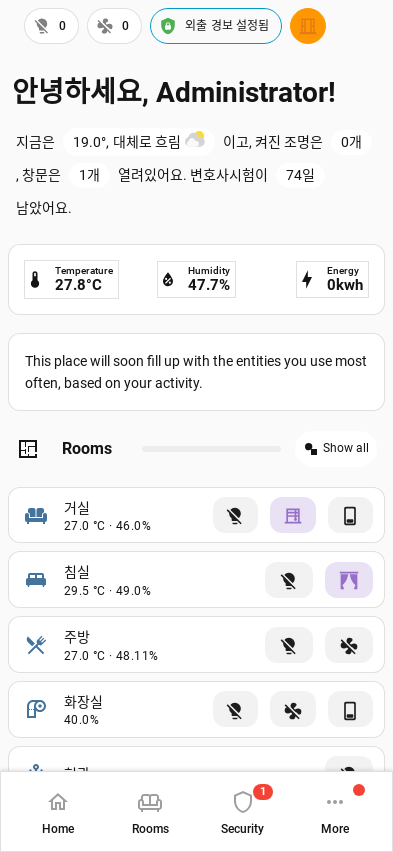
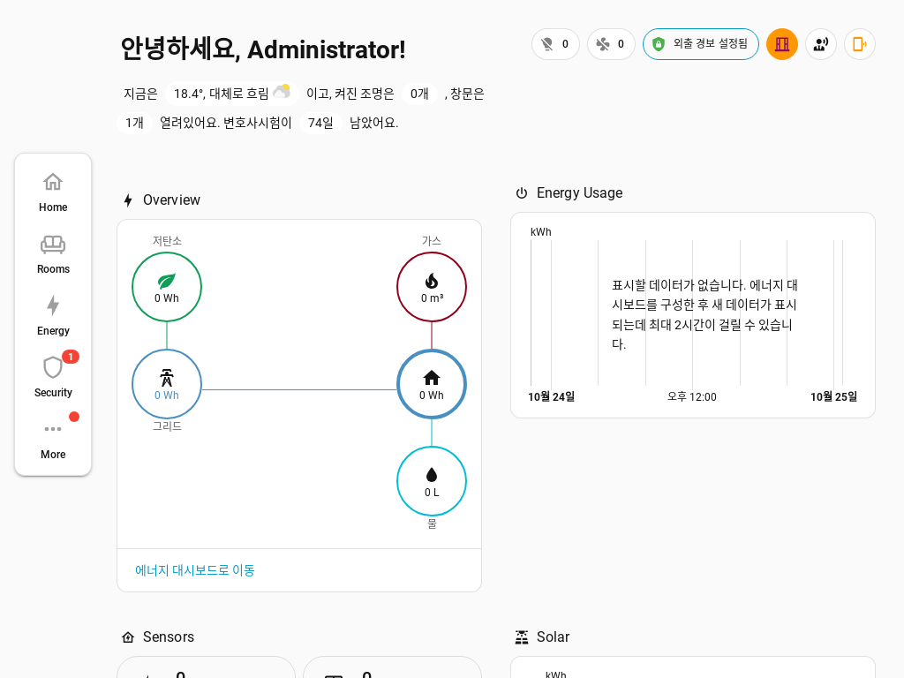

# Home Assistant Config

[![Maintained][maintenance-img]][github-url]

[![Last Commit][last-commit-img]][github-url]
[![Commit Activity][commit-activity-img]][github-url]
[![CI][ci-img]][github-url]
[![License][license-img]][license-url]
[![Stars][stars-img]][github-url]
[![Docs][docs-img]][docs-url]

> 2018년부터 운영 중인 개인 Home Assistant 설정. 1인 가구, 한국어 자동화 중심. (2026-10-30 갱신)

📚 **전체 문서: [saya6k.github.io/home-assistant-config][docs-url]**

---

## 한눈에 보기

  
  
  
  
  

<strong>📦 애드온</strong> (17)

| 이름 | 버전 | 상태 |
| --- | --- | --- |
| Advanced SSH & Web Terminal | `24.2.0` | started |
| CodeMirror | `0.7.0` | started |
| CRW Web Tools | `0.4.0` | started |
| ESPHome Device Builder | `2026.10.1` | started |
| Let's Encrypt | `6.5.0` | stopped |
| Matter Server | `9.2.0` | started |
| Memory | `0.6.0` | started |
| Mosquitto broker | `7.1.3` | started |
| Music Assistant | `2.10.8` | started |
| NGINX Home Assistant SSL proxy | `4.5.1` | started |
| NILM | `1.1.11` | stopped |
| OpenThread Border Router | `3.3.0` | started |
| Samba share | `12.10.0` | started |
| Supertonic | `2.7.0` | started |
| Wardrowbe | `4.3.7` | started |
| Whisper | `3.5.3` | stopped |
| YT Music PO Token Generator | `2.0.2` | started |

<strong>🧩 커스텀 통합</strong> (14)

- [Amano Parking System](https://saya6k.github.io/hacs-pweb-amano/) `0.3.1`
- [ANCS (iPhone Notifications)](https://github.com/saya6k/hacs-ancs) `0.0.0`
- [Chzzk](https://saya6k.github.io/hacs-chzzk/) `0.8.0`
- [Dyson](https://github.com/libdyson-wg/ha-dyson) `1.5.7`
- [Jinja Files](https://saya6k.github.io/hacs-jinja-files/) `1.1.0`
- [Korean Public Data](https://saya6k.github.io/hacs-korea-public-data/) `5.0.3`
- [Life360](https://github.com/pnbruckner/ha-life360/blob/0.10.4/README.md) `0.10.4`
- [LocalThings](https://github.com/mbillow/localthings) `0.35.0`
- [Naver Map](https://github.com/saya6k/hacs-naver-map) `0.4.0`
- [Restore Persistent Notifications](https://github.com/andreadegiovine/homeassistant-restore-persistent-notifications) `2025.11.9`
- [Spook](https://spook.boo) `5.11.1`
- [TrueNAS CE](https://github.com/kayl-codes/homeassistant-truenas) `2.13.0`
- [Wardrowbe](https://saya6k.github.io/hacs-wardrowbe/) `0.4.0`
- [xBloom Coffee Machine](https://saya6k.github.io/hacs-xbloom/) `2.2.1`

### 플랫폼

  
  
  
  
  
  

### 프로토콜

  
  
  
  

### 음성과 AI

  
  
  
  
  
  
  
  

### 서비스

  
  
  
  
  
  
  

---

## 문서 / Documentation

소스는 [`docs/`](./docs/) — zensical로 빌드되어 GitHub Pages에 배포됩니다.

| 영역 | 한국어 | English |
| --- | --- | --- |
| 하드웨어 | [hardware.md](./docs/hardware.md) | [en/hardware.md](./docs/en/hardware.md) |
| 플랫폼 | [platform/](./docs/platform/) | [en/platform/](./docs/en/platform/) |
| 통합 | [integrations/](./docs/integrations/) | [en/integrations/](./docs/en/integrations/) |
| 자동화 | [automations.md](./docs/automations.md) | [en/automations.md](./docs/en/automations.md) |
| 대시보드 | [dashboards.md](./docs/dashboards.md) | [en/dashboards.md](./docs/en/dashboards.md) |
| 음성과 AI | [voice-and-ai.md](./docs/voice-and-ai.md) | [en/voice-and-ai.md](./docs/en/voice-and-ai.md) |
| 옵저버빌리티 | [observability.md](./docs/observability.md) | [en/observability.md](./docs/en/observability.md) |
| 에너지 | [energy.md](./docs/energy.md) | [en/energy.md](./docs/en/energy.md) |
| 서비스 | [services/](./docs/services/) | [en/services/](./docs/en/services/) |
| 보관소 · 참고 | [retired.md](./docs/retired.md) · [resources.md](./docs/resources.md) | [en/retired.md](./docs/en/retired.md) · [en/resources.md](./docs/en/resources.md) |

## 도메인별 엔티티

| Domain | Count |
| --- | --- |
| automations | 50 |
| binary_sensors | 265 |
| device_trackers | 16 |
| lights | 17 |
| media_players | 21 |
| sensors | 1356 |
| switches | 429 |
| others | 959 |
| **Total** | **3113** |

## 화면

  
  
  

## License

MIT — see [LICENSE](LICENSE). `secrets.yaml` 은 포함되지 않습니다.

> [!CAUTION]
> 이 설정은 매일 진화합니다. 문서가 항상 최신은 아닐 수 있습니다.

<!-- Footnotes -->

[github-url]: https://github.com/saya6k/home-assistant-config
[license-url]: https://github.com/saya6k/home-assistant-config/blob/main/LICENSE
[docs-url]: https://saya6k.github.io/home-assistant-config

[maintenance-img]: https://img.shields.io/maintenance/yes/2026?style=flat-square
[last-commit-img]: https://img.shields.io/github/last-commit/saya6k/home-assistant-config?style=flat-square
[commit-activity-img]: https://img.shields.io/github/commit-activity/m/saya6k/home-assistant-config?style=flat-square
[ci-img]: https://img.shields.io/github/actions/workflow/status/saya6k/home-assistant-config/release.yml?style=flat-square&label=CI
[license-img]: https://img.shields.io/github/license/saya6k/home-assistant-config?style=flat-square
[stars-img]: https://img.shields.io/github/stars/saya6k/home-assistant-config?style=flat-square
[docs-img]: https://img.shields.io/badge/docs-saya6k.github.io-1f6feb?style=flat-square&logo=github

<!--
Generated by the [jinja_files custom integration](https://saya6k.github.io/hacs-jinja-files/).
Service: jinja_files.render
-->
